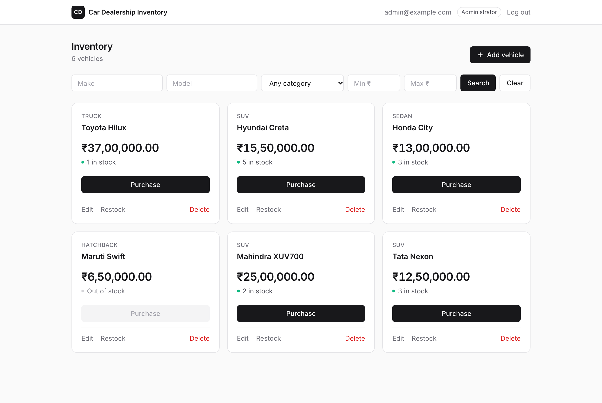
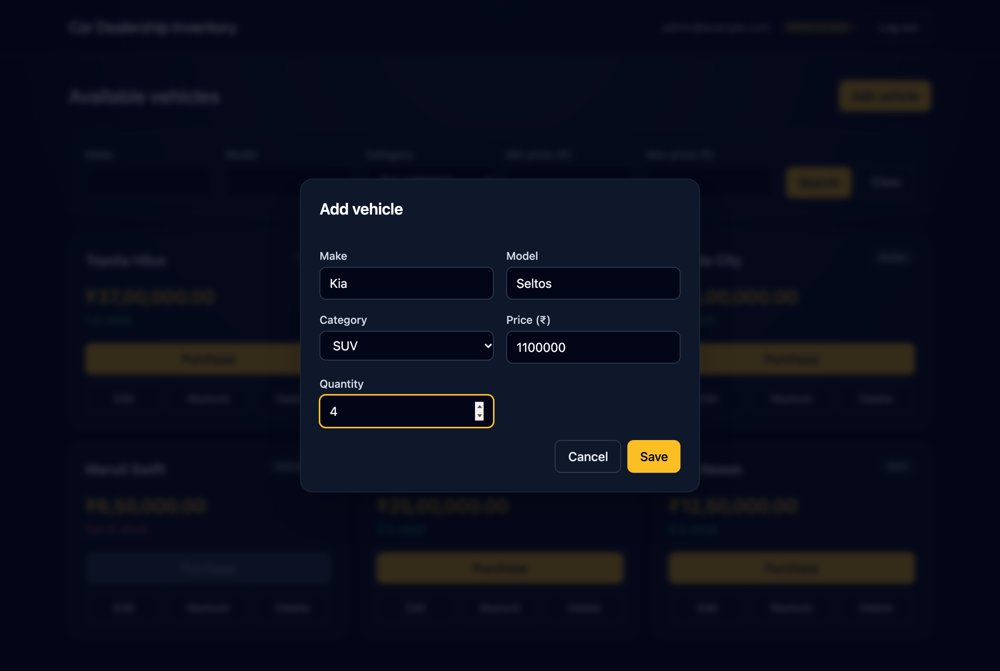
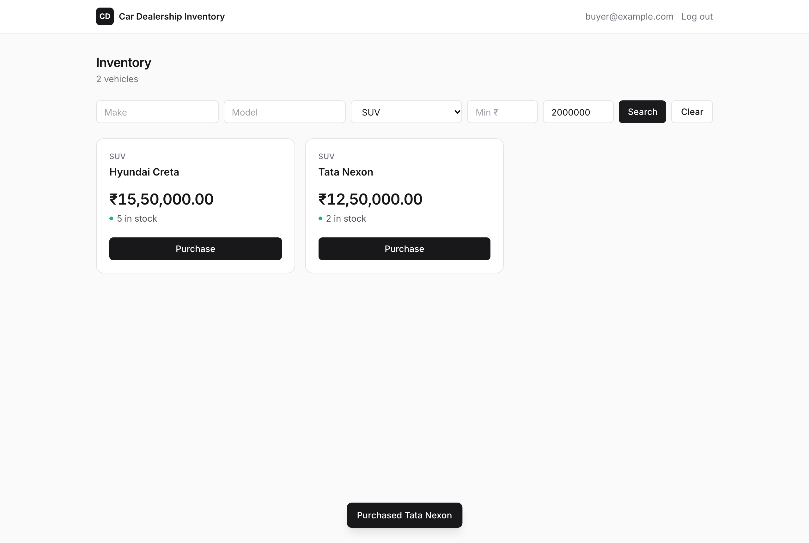
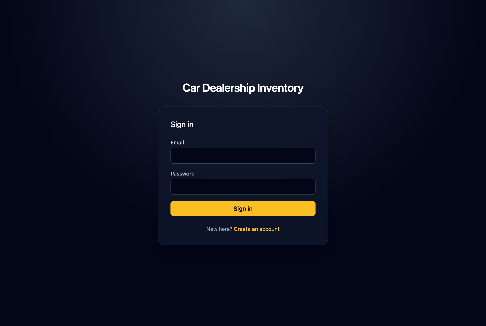
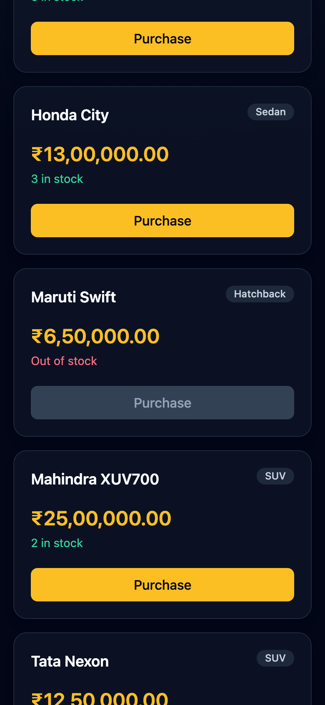

# Car Dealership Inventory System

[](https://github.com/SinghChinmayy/Kata-Car-Dealership-Inventory-System/actions/workflows/ci.yml)

A full-stack inventory system for a car dealership. Administrators manage vehicle listings and stock; signed-in users search the catalogue and buy vehicles one unit at a time. The backend is FastAPI with PostgreSQL, and the frontend is a React single-page app. Both were built test-first, and every change reaches `main` through a pull request that must pass lint, backend, frontend, and end-to-end checks ([how a change ships](#branch-protection-and-how-a-change-ships)).

## Screenshots

| Administrator dashboard | Adding a vehicle |
| --- | --- |
|  |  |

| Buyer search and purchase | Sign in | Phone layout |
| --- | --- | --- |
|  |  |  |

## Local development

This repository is a small monorepo: `backend/` contains the FastAPI API and Alembic migrations, and `frontend/` contains the React/Vite SPA. PostgreSQL runs in Docker; the API and SPA run on the host.

Prerequisites: Docker with a running daemon, [uv](https://docs.astral.sh/uv/), Node.js/npm, and Python 3.9 or newer.

```bash
cp .env.example .env   # then set JWT_SECRET, e.g. to the output of: openssl rand -hex 32
make db-up
cd backend && uv sync --all-groups && uv run alembic upgrade head
uv run python -m app.scripts.seed_admin
cd ../frontend && npm ci
```

The seed command (`make seed-admin`) creates the first Administrator from `INITIAL_ADMIN_EMAIL` and `INITIAL_ADMIN_PASSWORD` in `.env`, which follow the same rules as registration. It is safe to rerun, since an existing Administrator is left unchanged. If that email already belongs to a Standard User, the command refuses rather than promoting it, so nobody who registered the address first can inherit administrator rights. Change the example password before using it anywhere shared. The SPA's development server proxies `/api` to the API on port 8000, so open `http://localhost:5173`.

`make seed-demo` creates the published demo logins from `DEMO_ADMIN_*` and `DEMO_BUYER_*` in `.env` and resets the catalogue to eight sample vehicles, one of them sold out. Rerunning it is the reset: the demo accounts and their passwords are kept, every active listing is soft-deleted by the demo administrator, and a fresh copy of the samples is added, so purchase records keep their listings. It refuses a demo email that already belongs to an account with a different role. Set the matching `VITE_DEMO_*` variables when building the SPA to list both logins under the sign-in form, each with a button that fills it in; with them unset, nothing is shown.

Start the API with `cd backend && uv run uvicorn app.main:app --reload`, and the SPA with `cd frontend && npm run dev`. FastAPI's local OpenAPI documentation is available at `http://localhost:8000/docs`; `GET /health` verifies database readiness.

Common commands are exposed through the root `Makefile`: `make migrate`, `make test-backend`, `make test-frontend`, and `make lint`. Backend integration tests start one disposable PostgreSQL Testcontainers instance, migrate it once per session, and truncate application tables between tests. Docker must be running for that suite.

## Deployment

The app runs on Vercel as one project, `car-dealership-inventory`, with its database on Neon Postgres (added through the Vercel Marketplace). Both are in Singapore (`sin1` / `ap-southeast-1`), the closest Neon region to users in India. The plan and the reasoning behind it are in [plan/vercel_deployment.md](plan/vercel_deployment.md).

- The SPA is built from `frontend/` and served as static files; any path that is not a file falls back to `index.html`.
- `/api/*` and `/health` are rewritten to one Python function, `api/index.py`, which puts `backend/` on the import path and serves `app.main:app` with its original paths. Because the SPA and API share an origin, no CORS or `VITE_API_BASE_URL` is needed.
- Vercel installs the API from the root `requirements.txt`. Run `make requirements` whenever `backend/uv.lock` changes; a test fails until you do.
- `vercel.json` sets the framework to Other, because a detected FastAPI preset would ignore `api/`. Its `excludeFiles` keeps dotfiles (including `.env`), tests, docs, and the frontend source out of the function bundle.

Project environment variables (production and preview):

| Variable | Value |
| --- | --- |
| `DATABASE_URL`, `DATABASE_URL_UNPOOLED` | Added by the Neon integration. The app uses the pooled `DATABASE_URL` and rewrites its `postgres://` scheme for psycopg. |
| `JWT_SECRET` | A separate random secret for production and for preview. |
| `DB_POOL_SIZE` | `1`, because every function instance keeps its own pool. Prepared statements are always disabled, so queries are safe behind Neon's pooler. |
| `VITE_DEMO_*` | The published demo logins shown on the sign-in page. |

Continuous integration and deployment: the [CI](.github/workflows/ci.yml) GitHub Action runs on every pull request and every push to `main`, and can also be started by hand. Four jobs check the code:

| Job | What it runs |
| --- | --- |
| Lint | `make lint`: Ruff check and format, ESLint, Prettier |
| Backend tests | pytest against a Testcontainers PostgreSQL, failing below 95% coverage; JUnit and coverage XML are kept as run artifacts |
| Frontend tests and build | Vitest, then `npm run build`, the same type-check and bundle Vercel runs |
| End-to-end journey | The Playwright journey against a PostgreSQL service container, after both test jobs pass; its report and traces are kept when it fails |

On a push to `main`, once all four pass, a fifth job runs `alembic upgrade head` against Neon's direct URL, taken from the repository secret `DATABASE_URL_UNPOOLED`. It runs on every push, since at head the upgrade changes nothing, and a concurrency lock queues it so two migrations never run at once. Runs on `main` are never cancelled; a newer commit on a pull request cancels that pull request's older run.

The Vercel project is connected to this GitHub repository, so every push to `main` deploys to production and every pull request gets a preview deployment. Vercel does not wait for CI, so `main` is protected with these checks required (see below): only code that passed CI reaches `main` and production. The deploy and the migration run side by side, so a migration must keep working with the code that is still live: add columns or tables first, and remove old ones in a later release. Preview deployments use the production database, so a pull request with a new migration will run its preview against the old schema until it is merged.

Migrations and seeds can also run from a laptop with a linked project (`vercel link`), never during the Vercel build. `make vercel-migrate` runs `alembic upgrade head` against Neon's direct URL, and `make reset-demo` runs the demo seed with the logins taken from the project's `VITE_DEMO_*` variables. Both use `scripts/vercel_db.sh`, which pulls the project's variables into a temporary file and deletes it afterwards. The demo administrator is public, so anyone can edit or delete listings; `make reset-demo` puts the sample catalogue back. Production and preview deployments currently share one database.

### Branch protection and how a change ships

`main` is protected by a GitHub ruleset, `protect-main`. Its bypass list is empty, so the rules apply to everyone, administrators included.

| Rule | Setting |
| --- | --- |
| Pull request required | Direct pushes to `main` are rejected. No approving review is required, because this is a one-person repository, but every review conversation must be resolved before merging. |
| Required status checks | `Lint`, `Backend tests`, `Frontend tests and build`, and `End-to-end journey` must pass, reported by GitHub Actions only, on a branch that is up to date with `main`. |
| Merge method | Rebase only, with linear history. A squash merge would fold each failing-test commit and the implementation that made it pass into one commit, hiding the Red-Green-Refactor history. |
| Force pushes and deletion | Blocked. |

A change ships in four steps:

1. Work on a branch, writing the failing test first.
2. Push the branch and open a pull request. CI runs the four checks, and Vercel builds a preview deployment.
3. When all four checks pass and every conversation is resolved, rebase and merge.
4. The merge pushes to `main`: Vercel deploys it to production, while CI runs again and, once its checks pass, applies any new migrations to Neon.

## Test report

The latest results are in [docs/test-report.md](docs/test-report.md): backend and frontend pass counts and the backend coverage table. `make report` reruns both suites and overwrites the file, and it is refreshed with every green and refactor commit. Docker must be running for the backend suite. CI also runs every suite on each pull request and push to `main`; the badge at the top shows the latest result on `main`.

### End-to-end test

`make e2e` (or `cd frontend && npm run e2e`) runs one Playwright journey in Chromium:
1. An administrator signs in, adds a vehicle with one unit, and logs out.
2. A new buyer registers, searches for that vehicle, and buys it.
3. The test checks the confirmation and that the card shows "Out of stock" with Purchase disabled.

Playwright starts the API and the Vite dev server itself. The API uses a separate `dealership_e2e` database, which is dropped, migrated, and seeded with its own administrator on every run; the reset script refuses any database whose name does not end in `_e2e`. Requirements:
- PostgreSQL running on port 5432 (the `make db-up` service);
- ports 8000 and 5173 free;
- browsers installed once with `npx playwright install chromium`.

## Security scope and trade-offs

User registration normalizes email by trimming and lowercasing it, validates it as an email address, and protects it with a database unique index. A duplicate registration returns `409 Conflict`; this intentionally reveals that the email is already registered, an accepted trade-off for this kata. Login failures always return a generic `401 Unauthorized` response.

The project does not apply provider-specific email rules such as removing Gmail dots or `+` tags, because those transformations can merge distinct identities. Email verification, password reset, and profile fields are intentionally out of scope.

JWT access tokens contain only the account UUID and standard issuance/expiry claims. Each protected request therefore performs one database lookup to load the current account and role. That small per-request cost is deliberate: role changes take effect immediately instead of waiting for a role embedded in an existing token to expire.

Login and registration rate limiting is deferred. An in-process limit would not be a reliable protection once the application has multiple instances, and this kata does not include the shared rate-limit infrastructure needed to make that guarantee. It is a production-hardening follow-up.

## Assumptions and additions

Listings are not required to be unique by make, model, category, or price. The system treats the listing ID as the only uniqueness guarantee because the kata intentionally does not model details such as VIN, year, or trim.

A new listing starts with between 0 and 100,000 units. The cap catches typing mistakes such as an extra zero. Restock can still raise stock up to the database's integer limit.

Vehicle search (`GET /api/vehicles/search`) applies every supplied filter together (AND). Its open choices were resolved as follows:

- `make` and `model` match case-insensitively anywhere in the value, so `xuv` and `700` both find `XUV700`. `%` and `_` in a term are matched literally rather than as wildcards.
- Text terms are trimmed; an empty or whitespace-only term is ignored, so a cleared form field means "no filter".
- `q` is the combined search used by the app's single search box (at most 100 characters). Each word must match the make or the model, in any order: `hil`, `toyota hilux` and `hilux toy` all find a Toyota Hilux. Words also match despite a small typo (`hilx`, `toyta`, `nexn`). This uses PostgreSQL's `pg_trgm` word similarity with a 0.5 cut-off, enabled by migration 0008. With `q`, results are ordered closest match first, then newest. The brief's `make` and `model` filters are kept unchanged alongside it.
- `category` accepts a single value from the controlled vocabulary; any other value returns `422`.
- `min_price` and `max_price` are inclusive, must be non-negative with at most two decimal places, and `min_price` greater than `max_price` returns `422`.
- With no filters, search returns every active listing. Out-of-stock listings are included so the SPA can show them with a disabled Purchase button.
- Paging and ordering match `GET /api/vehicles`: `page`, `page_size` (default 20, capped at 100), newest first, with `total` counting all matches.
- Any authenticated user may search. No trigram index is added; at dealership catalogue sizes a sequential scan is fast, and a `pg_trgm` GIN index on make and model is the scaling follow-up.

Vehicle update (`PUT /api/vehicles/{id}`) resolves its open choices as follows:

- Only Administrators may update listings. The kata marks only delete and restock as admin-only, but its frontend section places update in the admin UI and the domain gives Standard Users no inventory-management authority, so a Standard User receives `403`.
- The request is a full replacement: `make`, `model`, `category`, and `price` are all required and follow the same rules as creation.
- `quantity` and any other unknown field return `422`; stock changes only through audited purchase and restock operations.
- An unknown listing ID returns `404`; a malformed ID returns `422` for the `listing_id` field.
- Success returns `200` with the updated listing. `updated_at` is refreshed on every update while `id`, `created_at`, and quantity are unchanged, so newest-first ordering is unaffected by edits.
- Concurrent administrator edits are last-write-wins. Because updates never touch quantity, they cannot lose a concurrent purchase or restock; optimistic locking is a possible future addition.

Vehicle deletion (`DELETE /api/vehicles/{id}`) is a soft delete, as recorded in ADR 0008. Its open choices were resolved as follows:

- Only Administrators may delete. Success returns `204 No Content`.
- The row is kept with its remaining quantity. `deleted_at` and `deleted_by` record when and by whom; a database check requires both to be set together, and `deleted_by` references the account with `ON DELETE RESTRICT`.
- Deleted listings disappear from list and search. Updating, or deleting again, returns `404`, and a second delete never rewrites the original deletion record. An unknown ID also returns `404`; a malformed ID returns `422`.
- Concurrent deletes are resolved by a single conditional `UPDATE ... WHERE deleted_at IS NULL`: the first wins and the other receives `404`.
- No partial index for active listings is added yet; `(created_at DESC, id DESC) WHERE deleted_at IS NULL` is the scaling follow-up. Restoring a deleted listing is out of scope.

Vehicle purchase (`POST /api/vehicles/{id}/purchase`) buys exactly one unit and takes no request body (ADR 0007). Its open choices were resolved as follows:

- Any authenticated account may purchase, Administrators included; ADR 0007 and the glossary were updated to say so.
- Success returns `200` with the updated listing, so the SPA can refresh the card and disable Purchase at zero. A purchase does not change the listing's `updated_at`, which tracks catalogue edits only.
- Each purchase stores a durable record in `purchases` with the purchaser and snapshots of price, make, model, and category. Later edits never change those snapshots. Both foreign keys use `ON DELETE RESTRICT`, and `purchaser_id` is indexed for a future "my purchases" view.
- An out-of-stock listing returns `409 out_of_stock`; a missing or deleted listing returns `404`.
- Stock is decremented by a single conditional `UPDATE ... WHERE quantity > 0 AND deleted_at IS NULL` in the same transaction as the purchase insert. A concurrency test fires 20 simultaneous purchases at a stock of 5 and expects exactly 5 successes, 15 conflicts, a final quantity of 0, and 5 purchase records. The commit history shows the naive read-then-write version failing that test (all 20 succeeded) before the atomic fix.

Vehicle restock (`POST /api/vehicles/{id}/restock`) adds stock and records a Stock Adjustment (ADR 0009). Its open choices were resolved as follows:

- Only Administrators may restock. The body is `{"quantity": n}`: required, a whole number of at least 1, with no other fields allowed. There is no per-request cap, but a restock that would push stock past PostgreSQL's `INTEGER` limit returns `422` on `quantity` instead of failing in the database.
- Success returns `200` with the updated listing. Like a purchase, a restock leaves `updated_at` unchanged.
- Each restock inserts a `stock_adjustments` row (listing, administrator, quantity, time) in the same transaction as the increment. Both foreign keys use `ON DELETE RESTRICT`, and `listing_id` is indexed for a future per-listing stock history.
- A missing or deleted listing returns `404`.
- The increment is a single relative `UPDATE ... SET quantity = quantity + :n`, so it cannot lose a concurrent purchase or restock. A guard test races 10 restocks against 10 purchases from zero stock and checks that stock always matches the purchase and adjustment records.
- The kata's admin UI lists only add, update, and delete. The SPA adds a per-listing restock control as well, because otherwise this endpoint could not be reached from the UI.

The single-page app resolves the frontend's open choices as follows:

- Routes are `/login`, `/register`, and a protected `/` dashboard. Anonymous visitors and unknown paths go to sign in; signed-in visitors skip the sign-in and registration pages. Registration signs the new account straight in.
- The access token is held in memory only (ADR 0003), so a browser refresh requires signing in again. Any `401` on a signed-in request ends the session, clears cached data, and returns to sign in with a notice.
- The SPA calls relative `/api` paths. In development Vite proxies them to FastAPI on port 8000; `VITE_API_BASE_URL` can point elsewhere for split hosting.
- The dashboard always uses the search endpoint and searches as you type. Text and price changes apply after a 300 ms pause, while a category choice, Enter, or Clear applies immediately. The applied filters and page number live in the URL, so back and forward restore them. Categories come from the API. Server validation errors appear beside the matching input.
- Each vehicle card shows the category, the INR price with Indian digit grouping (for example `₹12,50,000.00`), and the stock. Purchase happens in one click with no confirmation; the button is disabled at zero stock and while its request is in flight. A sold-out conflict is announced and the results refresh.
- Administrators see an Administrator badge, an Add vehicle button, and Edit, Restock, and Delete actions on each card. These open modal dialogs. Edit never sends quantity, and the delete confirmation focuses Cancel first.
- The design is a clean light theme set in Inter: white cards with thin zinc borders on a soft grey page, near-black primary buttons, small coloured stock dots, and quiet text-style admin actions with Delete in red. Filters sit in one compact row of visually hidden but labelled inputs, focus rings stay visible, and the grid runs from one column on phones to three on wide screens.
- Known accessibility gap: dialogs focus their first control and close on Escape, but they do not yet keep Tab focus inside the dialog or return focus to the button that opened them. Keyboard-only users can tab onto the page behind an open dialog.
- Component tests use Vitest, Testing Library with `user-event`, and MSW, which fails any test that makes an unexpected request. One Playwright journey exercises the real stack end to end.

## My AI Usage

I used OpenAI Codex to facilitate a structured architecture review before implementation. It helped compare the FastAPI/PostgreSQL stack, identify authorization and inventory edge cases, and record the resulting glossary and architecture decisions. I reviewed and selected each decision, including the explicit duplicate-email trade-off; AI accelerated the design discussion while the final scope choices remained mine.

I will also use Codex with the repository's `tdd-red-green-refactor` workflow during implementation. It will help turn each agreed behavior into one failing test, the smallest passing implementation, and—only when valuable—a refactor, while I verify test failures, review generated code, and retain the resulting Git history. Every AI-assisted commit will include the required co-author trailer, and this repository's `PROMPTS.md` retains the raw chat record.

I also used OpenAI Codex to package my red-green-refactor requirements as a repository skill and connect it to `AGENTS.md`. This gives future implementation work a concrete sequence for tests, code, commits, and verification. The workflow came from my requirements; Codex handled the skill formatting and repository wiring.

I used OpenAI Codex to scaffold the non-feature foundations: the FastAPI/Alembic project, PostgreSQL Docker configuration, Testcontainers fixture design, safe structured logging, and the Vite/React toolchain. I reviewed the resulting settings, commands, and test coverage before committing; Codex sped up the repetitive setup while the feature behavior remains reserved for the documented red-green-refactor sequence.

I used Claude Code (Anthropic) to analyse the repository state and suggest the next feature, then to interview me one question at a time on the vehicle search design: substring versus prefix matching, blank input, price bound semantics, category cardinality, out-of-stock visibility, access, indexing, and how to slice the work into TDD cycles. It offered a recommended answer for each question and I made the final calls. It then implemented search through separate red and green commits per behavior (inclusive price bounds, inverted range rejection, invalid filter values, blank terms, literal wildcards) and a final refactor sharing the page query with the list endpoint, running the full suite before every green and refactor commit. The question-by-question format surfaced edge cases, such as `%` in a search term matching everything, that I would otherwise have found later.

I repeated that process with Claude Code for vehicle update, deciding access, full versus partial replacement, unknown-field handling, malformed IDs, concurrency, and the response shape before any code was written. It drove four red-green cycles (full replacement, unknown listing 404, rejected extra fields such as `quantity`, malformed ID 422), added guard tests for rules that could not honestly start red, such as field validation and the administrator requirement, and finished with refactors that share catalogue validation between create and update.

For soft delete, Claude Code interviewed me on the response code, repeat deletes, the audit schema, concurrent deletes, and indexing, then drove five red-green cycles: soft deletion with its audit columns (migration 0005), hiding deleted listings from list and search, unknown-ID 404, repeat-delete 404 that preserves the original audit, and update-after-delete 404. It also checked the new migration's downgrade and upgrade against a disposable PostgreSQL container. One concrete catch: its first migration revision ID exceeded Alembic's 32-character version column, which the test suite exposed immediately.

For purchase, the Claude Code interview covered who may buy (I chose to let Administrators purchase and had ADR 0007 updated to match), the response code, the purchases schema, whether a sale counts as an edit, and how to tell the concurrency story honestly. It built the endpoint with a deliberately naive read-then-write decrement, added the purchase record, out-of-stock and not-found cycles, and a rollback guard that uses a temporary database trigger to make the purchase insert fail. Its concurrency test then showed the naive code letting all 20 buyers take 5 units, and the atomic conditional `UPDATE` fixed it. Seeing the oversell reproduce made the value of the atomic statement concrete rather than theoretical.

Before restock, I asked Claude Code to cross-reference the endpoint against the kata brief, ADRs, glossary, and TDD skill, which separated what was already decided from what was still open. The interview then settled the request body, limits (I chose no per-request cap), response, schema, concurrency proof, and the missing admin UI control. Claude Code drove four red-green cycles (restock, Stock Adjustment record with migration 0007, not-found, and integer-overflow rejection), plus guard tests for validation, authorization, rollback, and restocks racing purchases, then refactored the shared active-listing check and test trigger helper.

For the frontend, Claude Code read the existing toolchain and ADRs first, then interviewed me on test tooling (I approved adding MSW and `user-event`), API routing, routes, registration flow, session expiry, search UX, card and purchase behavior, admin dialogs, visual direction, and slicing. It built the SPA one red-green cycle per behavior: sign-in, the sign-in error, registration with auto sign-in, field errors, route guards, the listing grid, purchase, search filters, pagination, session expiry, admin-only controls, and the add, edit, delete, and restock dialogs. It then ran the real stack in a browser, which surfaced two layout issues that the component tests could not see: the filter buttons overflowing at mid widths, and Log out wrapping on phones. It also found that `.env.example`'s CORS value breaks settings parsing and that the admin seed command is still a placeholder.

I then had Claude Code fix those two setup bugs test-first and run an independent, read-only codebase audit in a subagent. The audit returned 15 ranked findings. The most serious was in code Claude Code had just written: the new seed command would promote whoever had registered the configured admin email first. We went through the findings one at a time; I asked for plain-language explanations where the trade-offs were technical, and chose each fix. The fixes were all test-first:
- the seed command now refuses an email owned by a standard account;
- a strong `JWT_SECRET` is required;
- routing errors and crashes use the standard error envelope, keep the request ID and CORS headers, and log a traceback;
- creating a listing caps its starting quantity, and page numbers are capped;
- the SPA no longer retries client errors, so an invalid search shows its error immediately;
- no error is hidden for lack of a matching input;
- the toast live region stays mounted for screen readers, and only one purchase can be in flight at a time;
- smaller hardening, plus guard tests for demotion and self-assigned roles.

I also agreed a routine: `make report` refreshes [docs/test-report.md](docs/test-report.md) on every green and refactor commit. I skipped the dialog focus-trap change and left older commit messages as they are. Having a second agent review the code without seeing our earlier reasoning caught a real security flaw that the original implementation pass had argued itself into.

Finally, I asked Claude Code to build the Playwright end-to-end journey in a subagent. It isolated the run in a throwaway `_e2e` database with a guarded reset, so my development data was never touched. It ran the journey three times without flakiness and found no application bugs; I then re-ran it in the main session to confirm.

For the visual refresh, I asked for a more modern, professional, and minimal UI. Claude Code first rendered four sample designs of the same dashboard for me to compare. I chose the clean light design, and a subagent restyled every screen to match it. It kept every label and accessible name the tests rely on, so no test changed. It also checked the result in a real browser at desktop and phone widths, which turned up a clipped category select on phones and stray gaps in two dialogs, both fixed before committing.

While trying the app, I noticed that typing a model ("Hilux") into the Make box found nothing, and asked for fuzzy, as-you-type search. Claude Code explained the cause first: separate Make and Model boxes. It then interviewed me on four choices: one box or two, how forgiving the matching should be, live versus button search, and whether to keep the brief's `make`/`model` API filters. It built the result test-first: a combined `q` parameter, multi-word and typo-tolerant matching with `pg_trgm`, relevance ordering, and debounced live search. It checked against my dev data before calling it done, and found that the "missing" Hilux had simply been deleted.

To deploy, I had Claude Code plan a Vercel setup and then build it one step at a time. It checked Vercel's current documentation before writing configuration, so it found that Vercel now recommends "Services" for a frontend plus a Python API; I chose the older `/api` folder method instead, because Services is still in beta. It made the API Neon-ready test-first: `postgres://` URL rewriting, a configurable pool size, and prepared statements turned off for Neon's pooler. Then it added the entry file, a `requirements.txt` with a drift test, and the Vercel config. A local `vercel build` caught a real leak: the function bundle included `.env` and `.env.local`, because local builds ignore `.vercelignore`. Claude Code narrowed `excludeFiles` until only runtime files remained. It also caught a test that broke coverage reporting, which had let one commit go in with a stale test report. I chose Singapore as the region and accepted Neon's terms. Claude Code set the JWT secrets without them ever appearing in the chat, ran the migrations, and confirmed with read-only checks that the pooled connection and `pg_trgm` worked. When I asked for public demo logins, it first warned me that a public admin lets anyone wipe the catalogue. I chose to add a reset as well, so the demo seed now creates both accounts, refuses addresses someone else registered first, and puts the sample catalogue back. A browser check found the logins truncated on the sign-in page, and Claude Code fixed that before shipping.

For continuous deployment, I asked Claude Code how deploys worked. It checked the Vercel project and found it was not connected to Git and there were no GitHub Actions, so every release so far had been a manual `vercel deploy --prod`. It then wrote a GitHub Action that applies Alembic migrations to Neon's direct URL on every push to `main` that changes `backend/`, with a concurrency lock so two migrations never run at once. It pointed out that Vercel's Git deploy and the migration run side by side, so migrations must stay backward compatible, and that previews share the production database. Connecting the repository in Vercel and storing the database URL as a GitHub secret were left to me, because they need my account settings and a secret.

I then asked Claude Code to analyse the codebase and suggest features ranked by importance. It put a CI test pipeline first: the only workflow was the migration, which would have changed the production database on a push to `main` even if the tests were failing. Before writing anything, I asked it to explain the plan. It then wrote one CI workflow with lint, backend, frontend, and end-to-end jobs, and moved the migration in as a final job that runs only on `main` after all four pass. It reused what the project already had: `make lint`, the Testcontainers backend suite, the build Vercel runs, and a PostgreSQL service with the credentials the Playwright journey expects. It ran each job's commands locally before calling the workflow done. It also pointed out that Vercel deploys without waiting for CI, so protecting `main` with required checks is the step that actually keeps failing code out of production, and left that setting to me.

For branch protection, I asked Claude Code what to enter in each field of GitHub's ruleset form, then created the ruleset myself. It recommended an empty bypass list, so the rules apply to me too; zero required approvals, because nobody else can approve my pull requests; and rebase-only merging, because squash merges would hide the red and green commits. When I asked it to check the saved ruleset through the GitHub API, it found that two settings had not been saved: the required-checks list was empty, so failing CI would not have blocked a merge, and squash merging was still allowed. With my go-ahead, it updated the ruleset through the API, changing only those two settings, and read it back to confirm.
